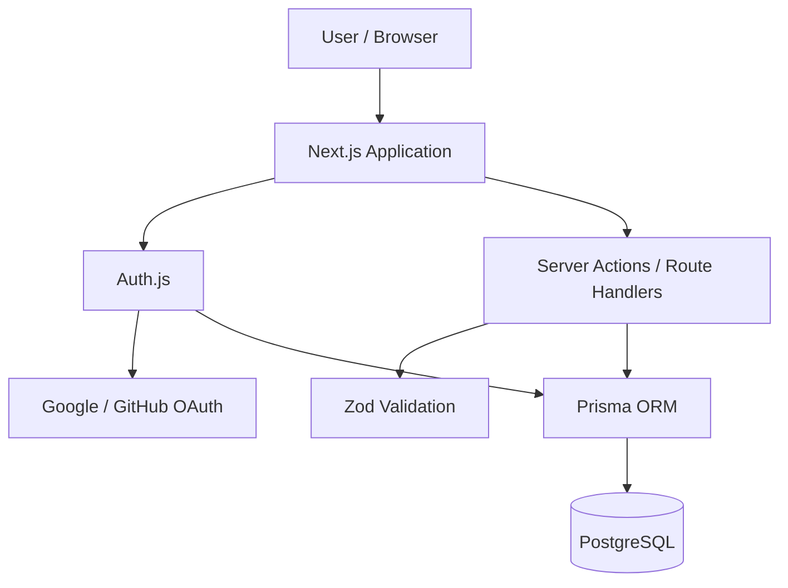

# Personal Finance Manager

A web-based personal finance application for recording, organizing, and managing financial transactions. Users can track income, expenses, withdrawals, and deposits, organize records by category and transaction mode, and retrieve financial records through flexible filtering and search.

- **Live application:** [https://finance-manager-web-app-puce.vercel.app](https://finance-manager-web-app-puce.vercel.app)
- **GitHub repository:** [https://github.com/Ivan-Alexis-Tan/finance-manager-web-app](https://github.com/Ivan-Alexis-Tan/finance-manager-web-app)

## Features

### Authentication and user access

- Sign in using Google or GitHub OAuth.
- Manage authenticated sessions using Auth.js.
- Persist authentication data using PostgreSQL through Prisma Adapter.
- Associate financial transactions with their respective user accounts.

### Transaction management

The application supports four types of financial transactions:

- `expenses`
- `income`
- `withdraw`
- `deposit`

Each transaction contains the following information:

| Field | Description |
| --- | --- |
| Date | Date when the transaction was recorded. |
| Details | Product name, transaction description, or other identifying information. |
| Quantity | Number of units associated with the transaction. |
| Amount | Amount per unit. |
| Total | Calculated transaction amount (`quantity × amount`). |
| Transaction | Type of financial transaction. |
| Transaction Mode | Where the financial activity is associated, such as stash, mobile bank, or bank. |
| Category | Classification of the transaction, such as food, entertainment, personal necessities, or household necessities. |

Additional functionality:

- Create new financial transactions.
- Edit existing transactions.
- Delete existing transactions.
- Organize financial records using transaction categories and modes.

### Deferred bulk entry

Instead of requiring users to save every transaction individually, the application provides a temporary entry workflow for recording multiple transactions.

- Add multiple transactions to a pending entry list.
- Store unsaved entries in browser `localStorage`.
- Retain pending entries across logout and subsequent login sessions on the same browser.
- Review accumulated entries before submitting them.
- Save multiple transactions to the database together.
- Discard pending entries when they are no longer needed.

This workflow is useful when recording several transactions at the end of the day. Users can prepare their entries first and submit them together instead of repeatedly completing individual submissions.

### Transaction filtering and search

- Apply numerical comparison operators to transaction fields.
- Filter records using conditions such as greater than, less than, equal to, and greater than or equal to.
- Use the transaction details field for text-based searching.
- Select filtering criteria through the available filter controls.
- Navigate through matching records using pagination.

## Technology Stack

### Frontend

- [Next.js](https://nextjs.org/) 16
- [React](https://react.dev/) 19
- [TypeScript](https://www.typescriptlang.org/)
- [Tailwind CSS](https://tailwindcss.com/) 4

### Application and server-side logic

- [Next.js Server Actions](https://nextjs.org/docs/app/getting-started/updating-data)
- [Next.js Route Handlers](https://nextjs.org/docs/app/api-reference/file-conventions/route)
- [Auth.js](https://authjs.dev/) v5
- [Prisma ORM](https://www.prisma.io/) 7
- [Zod](https://zod.dev/) for input validation

### Database and deployment

- [PostgreSQL](https://www.postgresql.org/) 17
- [Vercel](https://vercel.com/) for deployment

## Architecture

The application follows a full-stack architecture within a single Next.js project. The frontend, server-side operations, authentication, and database access are handled within the same application.



### Authentication

Auth.js handles authentication through Google and GitHub OAuth providers. Prisma Adapter integrates authentication with PostgreSQL, allowing authentication-related data and sessions to be persisted in the database.

### Transaction processing and persistence

Prisma handles database operations for creating, retrieving, updating, and deleting financial transaction records.

Each transaction is associated with a user account, allowing financial records to be managed in relation to their respective owners.

The application also supports bulk transaction submission, allowing multiple records to be saved together instead of requiring a separate database submission for every entry.

### Temporary transaction storage

Pending bulk entries are stored in browser `localStorage` rather than immediately being persisted to PostgreSQL.

This separates the preparation of transaction records from their actual database submission. Users can accumulate entries, review them, and decide when to save or discard them.

### Transaction retrieval

The application supports transaction retrieval with search, filtering, and pagination.

Numerical fields can be filtered using comparison operators, while the details field supports text-based searching. This allows users to locate specific records without manually navigating through their entire transaction history.

## Motivation

This project was built as both a portfolio project and a practical personal finance tracker.

One of the problems I wanted to address was the inconvenience of recording transactions individually. When several financial activities happen throughout the day, entering and saving each transaction separately becomes tedious. This led to the implementation of a deferred bulk-entry workflow, allowing users to accumulate transaction records and save them together when ready.

The project also provided an opportunity to explore full-stack development using Next.js, implement authentication, work with relational databases, and build server-side data management features.

## What I Learned

- Building a full-stack application using the Next.js App Router.
- Implementing OAuth authentication and database-backed sessions using Auth.js.
- Integrating PostgreSQL with Prisma ORM.
- Designing database operations for financial transaction management.
- Implementing bulk transaction entry and temporary client-side storage.
- Building flexible server-side filtering, searching, and pagination.
- Validating incoming data using Zod.
- Structuring server-side operations using Server Actions and Route Handlers.
- Debugging authentication, database, and deployment issues in a production environment.

## Future Improvements

- Financial dashboard with income and expense summaries.
- Interactive charts and financial visualizations.
- Monthly and yearly financial reports.
- Budget planning and expense tracking.
- Savings goals and progress tracking.
- Category-based financial analytics.
- CSV and Excel export.
- Recurring transactions.

## Prerequisites

- Node.js
- pnpm
- PostgreSQL

## Installation

### 1. Clone the repository

```bash
git clone https://github.com/Ivan-Alexis-Tan/finance-manager-web-app.git
cd finance-manager-web-app
```

### 2. Install dependencies

```bash
pnpm install
```

### 3. Configure environment variables

Create a `.env` file in the project root and configure the required variables.

See [Environment Variables](#environment-variables).

### 4. Generate Prisma Client

```bash
pnpm prisma generate
```

### 5. Apply database migrations

```bash
pnpm prisma migrate deploy
```

Make sure the PostgreSQL database exists and the connection string is correctly configured before applying migrations.

### 6. Start the development server

```bash
pnpm dev
```

The application will normally be available at [http://localhost:3000](http://localhost:3000).

## Environment Variables

Create a `.env` file in the project root.

| Variable | Description |
| --- | --- |
| `DATABASE_URL` | PostgreSQL connection string. |
| `AUTH_SECRET` | Secret used by Auth.js. |
| `AUTH_GITHUB_ID` | GitHub OAuth application client ID. |
| `AUTH_GITHUB_SECRET` | GitHub OAuth application client secret. |
| `AUTH_GOOGLE_ID` | Google OAuth application client ID. |
| `AUTH_GOOGLE_SECRET` | Google OAuth application client secret. |

Google and GitHub OAuth applications must be configured with the appropriate callback URLs for local development and production deployment.